## 1. Introduction: a quieter shift than the headlines suggest

Offensive security changed shape over the last two years. We moved from "AI-assisted"
tooling, where a model helped a human write a payload, to agentic workflows where a model
drives the engagement itself: reasoning about a target, calling security tools, and chaining
steps across a network with limited human supervision.

A few numbers explain why this happened now:

- A mid-size SaaS company exposes 300+ endpoints and dozens of internal APIs spread across
  several clouds.
- The gap between a vulnerability being disclosed and exploited in the wild keeps shrinking,
  often down to a handful of days.
- Breakout time, the delay before an attacker moves laterally after the first foothold, is
  frequently measured in minutes rather than hours.

Manual pentesting struggles to keep up with that pace, for four practical reasons:

1. **Exposure window.** A pentest is a snapshot at a single point in time, while CI/CD ships
   changes continuously.
2. **Velocity.** Attackers operate in days or minutes; a manual engagement runs over weeks.
3. **Cost asymmetry.** A human engagement runs from roughly $10k to $100k, while an autonomous
   agent runs at a few dollars per hour.
4. **Scale.** You simply cannot test hundreds of endpoints by hand within a normal engagement
   window.

None of this means manual testing is dead. It means the routine, high-volume work is moving
to machines, and human time is shifting toward the things machines still get wrong.

---

## 2. The fundamentals still hold

Even with agents in the loop, the methodology hasn't really changed. The five classic phases
are still the backbone of any engagement:

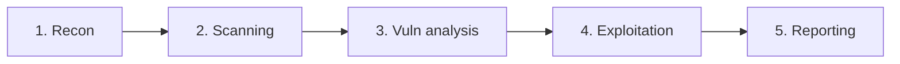

| Phase             | What happens                                               |
| ----------------- | ---------------------------------------------------------- |
| Recon             | Passive (OSINT) or active information gathering            |
| Scanning          | Technical mapping: ports, services, OS (Nmap, etc.)        |
| Vuln analysis     | Cross-referencing CVE/NVD, CVSS scoring                    |
| Exploitation      | Real compromise, impact proof, post-exploitation           |
| Reporting         | Executive summary + technical report + remediation         |

The same four reference frameworks still apply:

- **NIST SP 800-115** : technical, four phases, sometimes considered rigid against newer
  threats.
- **OWASP WSTG** : the go-to for web testing (SQLi, XSS, auth), stack-agnostic.
- **PTES** : the most complete, covering the engagement end to end.
- **MITRE ATT&CK** : not a methodology but a knowledge base of tactics and techniques, and the
  common language teams use to describe adversaries.

---

## 3. What an agentic pentester actually is

A pentesting agent is a system driven by a capable LLM that can run recon, vulnerability
scanning, active exploitation and report writing on its own. The important distinction from a
"copilot" is agency: a copilot suggests, an agent decides and acts.

Most of these systems share a similar shape:

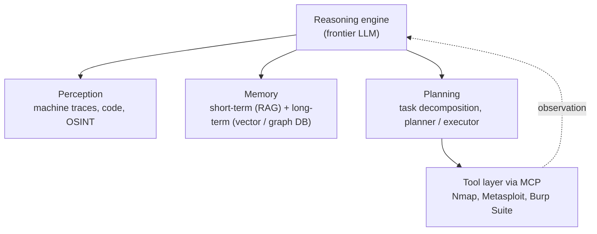

At the center sits a reasoning loop, usually some variant of ReAct (reason, then act). The
agent observes, reasons about what it sees, takes an action, then feeds the result back in:

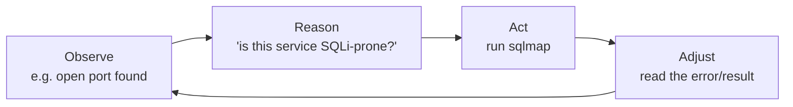

Memory is what separates a toy from something useful. Short-term memory (RAG) holds the
session context and recent exploit data; long-term memory in a vector or graph store keeps
track of which techniques worked against which kinds of targets, so the agent can reuse what
it learned.

For larger engagements, a planner/executor split helps. One agent owns the strategy and hands
sub-goals to specialized executors, each with its own context window so the scan data doesn't
overflow a single model's memory:

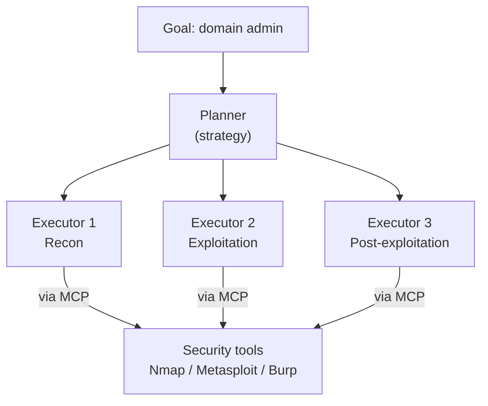

---

## 4. The tooling landscape

By 2026 there are dozens of open-source pentesting agents, and they roughly fall into three
groups:

| Tier   | Focus                       | Examples                                          |
| ------ | --------------------------- | ------------------------------------------------- |
| Tier 1 | Production, continuous       | PentAGI, Zen-AI-Pentest, PentestGPT               |
| Tier 2 | Research / niche             | VulnBot, ARACNE (SSH), HackSynth, BlacksmithAI    |
| Tier 3 | MCP / IDE-native             | HexStrike AI, Raptor, AutoPentest-AI              |

On the model side, the gap between frontier models matters less than people assume. A smaller
model fine-tuned for offensive security can beat a much larger general-purpose one. The
clearest example is the "lab-to-real" gap: models exploit a high share of one-day CVEs when
given a good description of the bug, but that number collapses without context. Reasoning,
not raw size, is still the bottleneck.

One result worth keeping in mind: a recently published frontier model reportedly found a
decades-old flaw in a widely used codebase that traditional fuzzers had hammered millions of
times without success. Capability is real. So is the tendency to over-claim it, which is why
independent reproduction still matters.

---

## 5. Recon and scanning

Recon is where agents pay off fastest. Instead of running a fixed playbook, the agent
orchestrates the usual OSINT tooling and prioritizes what looks weak:

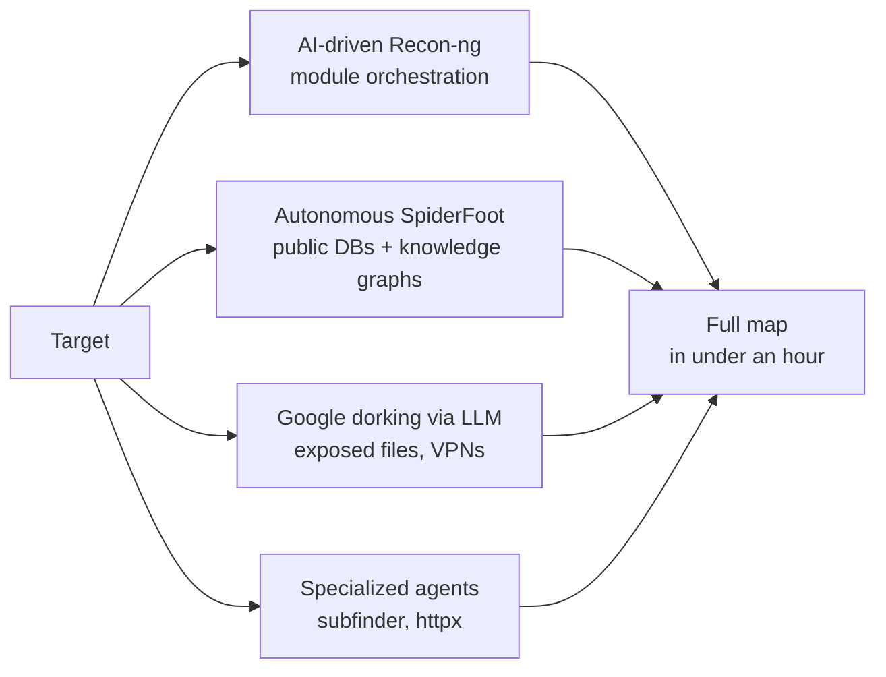

In practice this turns a four-to-six hour recon pass into something closer to forty minutes,
and the agent tends to surface the small fraction of assets that are actually worth attacking
first (old service versions, leaky certificate metadata, forgotten subdomains).

Scanning works the same way. A natural-language request becomes an optimized Nmap command, an
automated host-discovery script, and an evasion strategy, without the operator memorizing
flags:

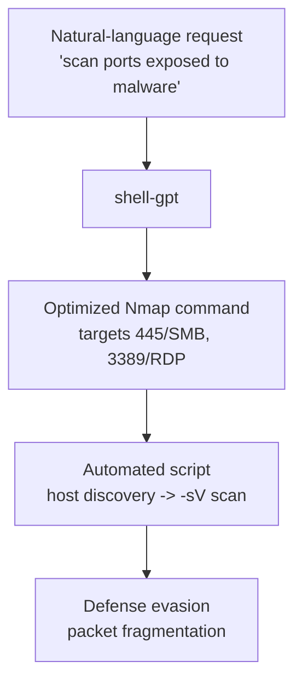

The same idea extends to detection content. From a one-line description, a model can generate
a working Nuclei template in seconds, including for business-logic issues like an SSRF through
a redirect parameter.

---

## 6. Social engineering

This is the area where automation has had the most uncomfortable impact, because it scales the
human side of attacks that used to be labor-intensive:

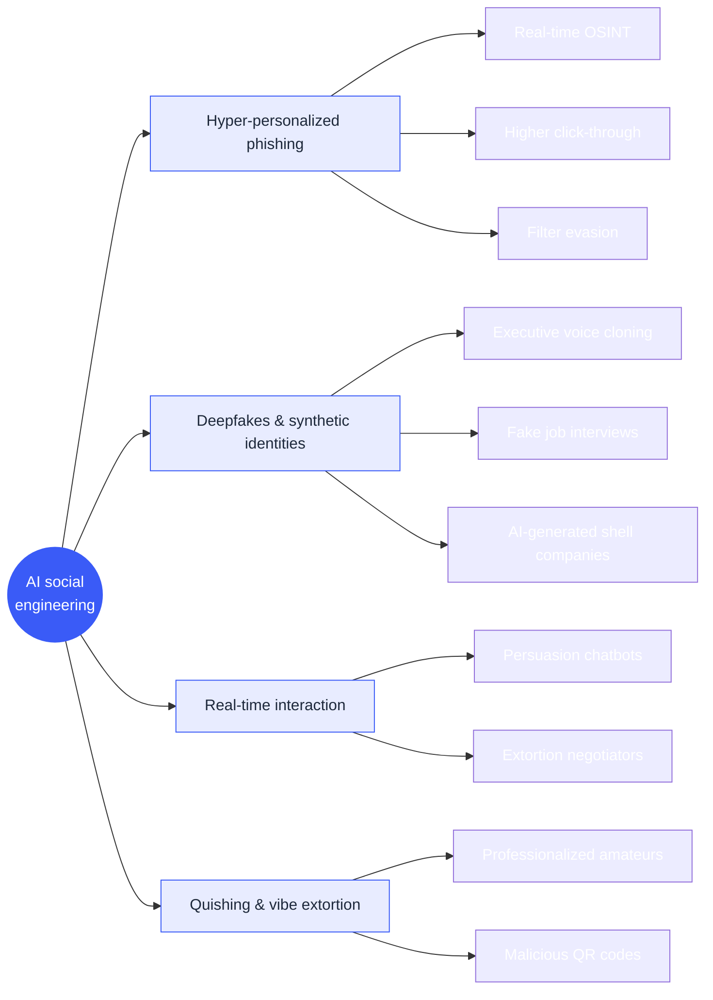

A few things stand out. Spear phishing is now enriched automatically from LinkedIn, news and
public code. Voice cloning is good enough to impersonate an executive or IT support over the
phone. And QR-code phishing routinely slips past email filters that only inspect links and
text.

---

## 7. Exploitation and post-exploitation

Payload generation is largely a solved problem for known cases. The agent drafts a payload,
tests it in a sandbox, and iterates on failures before touching the real target:

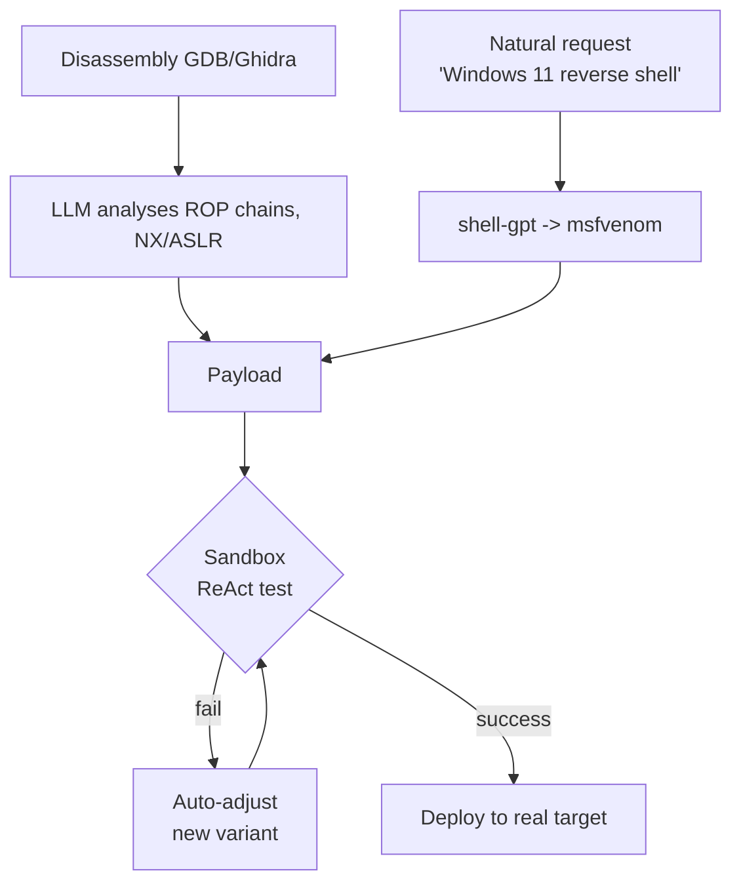

The evasion techniques themselves aren't new  dynamic obfuscation, in-memory execution,
encoding and fragmentation  but generating and tuning them is now fast enough that a
freshly disclosed CVE can be weaponized within minutes.

Privilege escalation and lateral movement follow the same assisted pattern. The operator
asks for escalation vectors, the agent runs the enumeration, reads the output, and returns a
ready command:

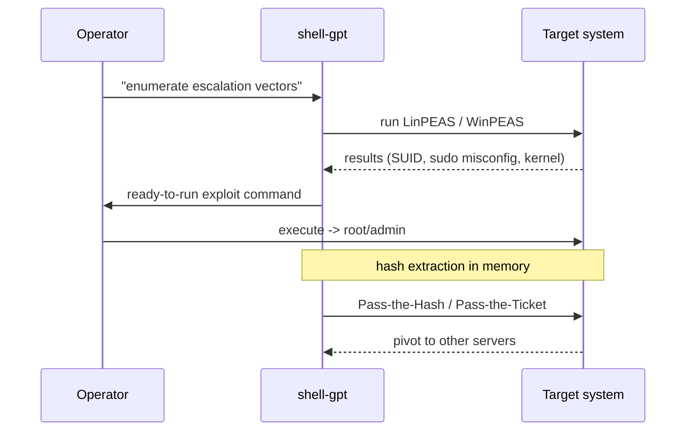

The value here is mostly about speed and fewer mistakes, and it lowers the bar for less
experienced operators, which cuts both ways.

---

## 8. Where agents still fail: business logic

This is the part I find most reassuring as a human in the field. The large majority of the
critical web vulnerabilities found today live in business logic, and that is exactly where
agents are weakest.

The reason is simple. A model is good at understanding what the code does  the syntax, the
API calls. It is much worse at understanding what the application is *supposed* to allow,
because that intent lives in the heads of the people who built it, not in the source:

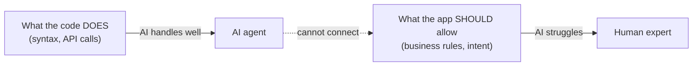

Broken object and function-level authorization (BOLA/BFLA) are the classic example: spotting
them requires reasoning across several user contexts at once, and agents tend to miss them.
Recent comparative studies show the same thing  agents cover more ground faster, but the
best human testers still find the subtle logic flaws that an agent doesn't even register as
bugs.

Which is why the practical model today is a split, not a replacement:

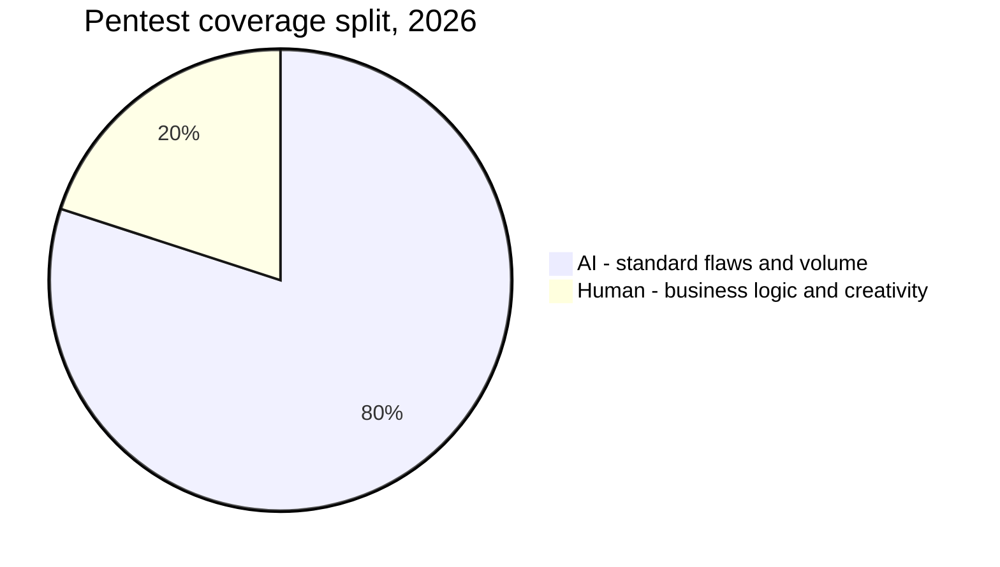

---

## 9. Reporting

Reporting used to eat a large chunk of an engagement. Now an agent can turn raw logs and
exploitation traces into a first draft in well under a minute:

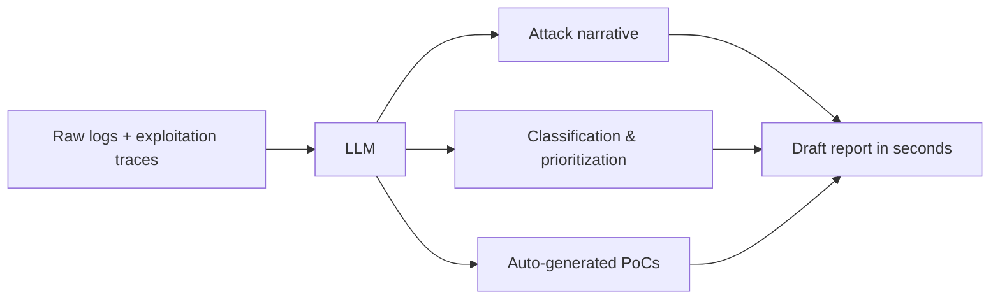

The bigger win is audience targeting. The same findings get rewritten for two very different
readers  a short, jargon-free summary for leadership focused on business impact, and a
detailed technical write-up for developers with CVEs, CVSS, reproduction steps and fixes:

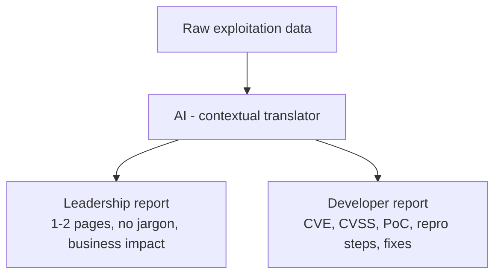

Prioritization is getting smarter too. Instead of a static CVSS score, tools now compute a
context-aware severity  does the finding actually reach something that matters, like domain
admin, backups or regulated data  and confirm it through real exploitation in a sandbox
before flagging it as urgent. A short, medium and long-term roadmap then turns the findings
into a plan rather than a list:

| Horizon     | Window     | Goal                              |
| ----------- | ---------- | --------------------------------- |
| Short term  | 1-3 months | Kill critical risks               |
| Medium term | 3-6 months | Improve security hygiene          |
| Long term   | 6-12 months| Architecture and process changes  |

---

## 10. Numbers worth quoting

Two data points stuck with me from the past year.

The DARPA AI Cyber Challenge jumped from roughly 37% vulnerability detection in its
semi-finals to around 86% detection (and 68% repair) in the finals a year later, with the
finalist systems open-sourced afterward. That kind of year-over-year jump is rare.

The other is a controlled study pitting a single agent against ten certified pentesters on a
real network of around 8,000 hosts:

| Metric                | Value                              |
| --------------------- | ---------------------------------- |
| Scope                 | ~8,000 hosts, 12 subnets           |
| Participants          | 1 AI agent vs 10 certified testers |
| AI ranking            | 2nd of 11, ahead of 9 of 10 humans |
| Vulns found by the AI | 9 (82% precision)                  |
| Best human            | 13 vulnerabilities                 |

So the honest read is: an agent beat almost every human in the room, for a fraction of the
cost, and still lost to the best one. That gap is the whole story.

---

## 11. Where this leaves the human

The shift isn't really "AI replaces pentesters." It's that the annual snapshot is giving way
to continuous validation. Agents run around the clock inside CI/CD pipelines, finding and
re-checking issues before code reaches production, which slowly closes the exposure window
that manual testing could never fully cover.

The pentester's job moves up a level:

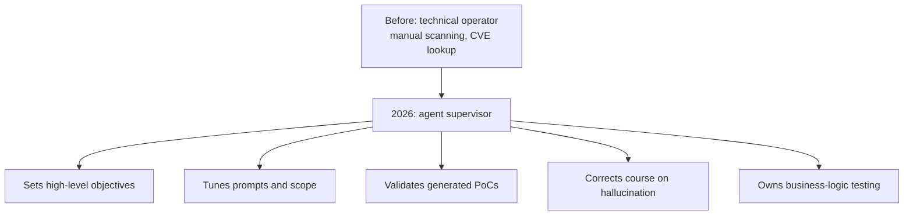

If I had to sum it up: the value of a good security engineer is no longer knowing the tools by
heart. It's the ability to point these agents at the right problems, catch them when they go
sideways, and stay the person who notices the design flaw the machine can't see yet.
